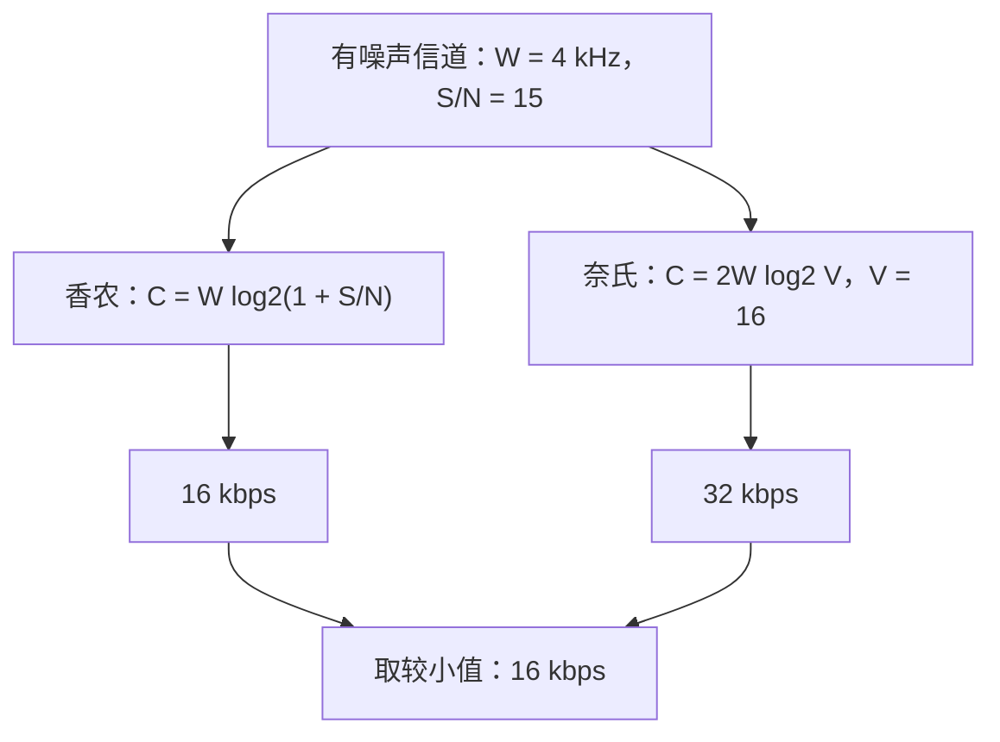

## 1. 题目

| 项目 | 内容 |
| :---: | :--- |
| **来源** | BOK27 考研每日一题 |
| **科目** | 计算机网络（CN） |
| **涉及知识点** | 香农公式、奈氏准则、有噪声信道容量 |

**题目内容**：某通信系统使用带宽为 $4\text{ kHz}$ 的有噪声信道，信噪比 $S/N=15$。系统采用 $16$ 种不同的码元状态，则该信道的最高数据传输速率为（ ）。

**选项**：

- A. $8\text{ kbps}$
- B. $16\text{ kbps}$
- C. $32\text{ kbps}$
- D. $64\text{ kbps}$

<!-- more -->

## 2. 我的作答

✘ 本题作答错误

**我的答案**：D

**错选**：D

## 3. 正确答案与解析

**正确答案**：**B**

**题目解析**：

deepseek/deepseek-v4-flash 精修于 2026-11-09 16:25

已知 $W=4\text{ kHz}=4\times10^3\text{ Hz}$，$S/N=15$，码元状态数 $V=16$。

**香农公式**（有噪声信道）：

$$
\begin{aligned}
C_{\text{香农}}
&=W\log_2\left(1+\frac{S}{N}\right)\\
&=4\times10^3\times\log_2(1+15)\\
&=4\times10^3\times4\\
&=16\text{ kbps}
\end{aligned}
$$

**奈氏准则**（理想无噪声低通信道）：

$$
\begin{aligned}
C_{\text{奈氏}}
&=2W\log_2 V\\
&=2\times4\times10^3\times\log_2 16\\
&=2\times4\times10^3\times4\\
&=32\text{ kbps}
\end{aligned}
$$

信道有噪声，实际最高数据传输速率受两者共同约束，取较小值：

$$
C_{\max}=\min(16,32)=16\text{ kbps}
$$

故选 B。

**图解**：

deepseek/deepseek-v4-flash 生成于 2026-11-09 20:25

**精修说明**：原解析“两个公式均计算取最小，一般是香农公式”方向正确，但表述不完整。严格做法是**两式都算、取较小值**；本题香农结果更小，才成为瓶颈。不能在任何情况下都直接套香农，否则当 $V$ 很小、奈氏结果更小时会出错。

**解题关键**：

> 有噪声信道要同时考虑“带宽 + 信噪比”和“带宽 + 码元状态数”，分别用香农公式与奈氏准则计算，取较小者作为最高数据率。

## 4. 知识点补充

deepseek/deepseek-v4-flash 生成于 2026-11-09 16:25

### 4.1 香农公式

$$
C=W\log_2\left(1+\frac{S}{N}\right)
$$

| 符号 | 含义 | 单位 |
| :---: | :--- | :---: |
| $C$ | 信道极限数据传输速率 | $\text{b/s}$ |
| $W$ | 信道带宽 | $\text{Hz}$ |
| $S/N$ | 信号平均功率与噪声平均功率之比（功率比） | 无量纲 |
| $S$、$N$ | 信号功率、噪声功率 | $\text{W}$ |

若题目给出的是分贝值 $D$（单位 $\text{dB}$），先换算：

$$
\frac{S}{N}=10^{D/10}
$$

### 4.2 奈氏准则

$$
C=2W\log_2 V
$$

- 适用条件：**理想低通、无噪声**信道。
- $W$ 为带宽（$\text{Hz}$），$V$ 为一个码元可取的离散状态数。
- 每个码元携带 $\log_2 V$ 个比特。
- 波特率（码元速率）$B=2W$（理想低通信道），比特率 $=B\log_2 V$。

### 4.3 易混淆概念

> **奈氏准则 vs 香农公式**：奈氏准则假设**无噪声**，只受带宽和码元状态数限制；香农公式把**噪声**纳入，给出有噪声信道的极限。有噪声时两者都要算，取较小值。

> **$S/N=15$ vs $15\text{ dB}$**：$S/N=15$ 是功率比，直接代入香农公式；若是 $15\text{ dB}$，应先换算为 $S/N=10^{1.5}\approx31.6$，两者差别很大。

> **码元速率 vs 数据传输速率**：码元速率单位是波特（Baud），数据速率单位是 $\text{b/s}$；二者相差 $\log_2 V$ 倍。本题 $16$ 种状态意味着每码元 $4$ bit，但不能直接把 $4\text{ kHz}$ 乘 $4$。
