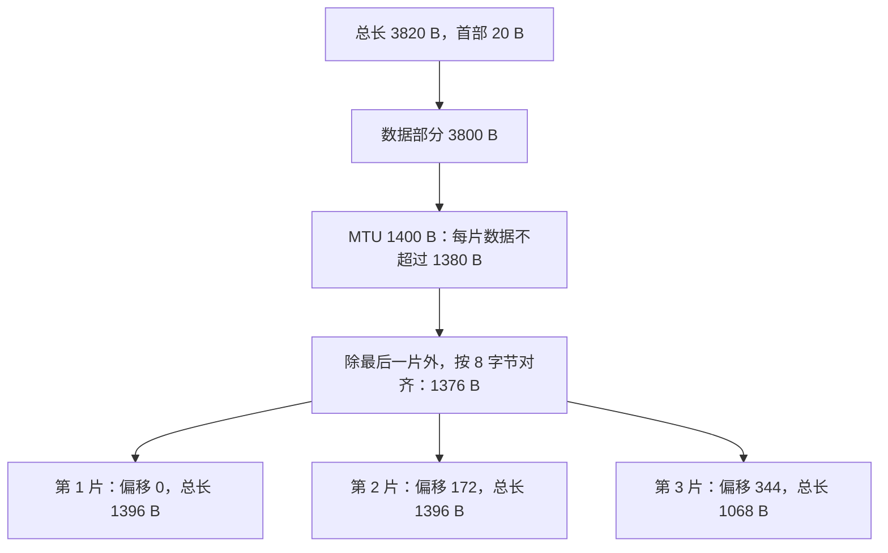

## 1. 题目

| 项目 | 内容 |
| :---: | :--- |
| **来源** | BOK27 考研每日一题 |
| **科目** | 计算机网络（CN） |
| **涉及知识点** | IPv4 数据报分片、MTU、片偏移 |

**题目内容**：某 IPv4 数据报总长度为 $3820\text{ B}$，首部长度为 $20\text{ B}$。该数据报经过一个链路层 MTU 为 $1400\text{ B}$ 的网络时需要分片，且各分片首部长度均为 $20\text{ B}$。则第 $3$ 个分片的片偏移字段值和总长度分别为（ ）。

**选项**：

- A. $172,\ 1396\text{ B}$
- B. $344,\ 1068\text{ B}$
- C. $345,\ 1060\text{ B}$
- D. $344,\ 1048\text{ B}$

<!-- more -->

## 2. 我的作答

✘ 本题作答错误

**我的答案**：C

**错选**：C

## 3. 正确答案与解析

**正确答案**：**B**

**题目解析**：

deepseek/deepseek-v4-flash 精修于 2026-11-09 16:25

**第一步：求数据部分长度。**

$$
3820-20=3800\text{ B}
$$

**第二步：求每片可携带的最大数据长度。**

MTU 限制的是**整个 IP 数据报**（首部 + 数据）的长度，因此每片数据部分最多为

$$
1400-20=1380\text{ B}
$$

除最后一片外，每片数据长度必须是 $8$ 的整数倍：

$$
\left\lfloor\frac{1380}{8}\right\rfloor\times8=172\times8=1376\text{ B}
$$

**第三步：分片。**

前两片各携带 $1376\text{ B}$，剩余

$$
3800-2\times1376=3800-2752=1048\text{ B}
$$

| 分片 | 数据范围（字节） | 数据长度 | 片偏移 | 总长度 | MF |
| :---: | :---: | :---: | :---: | :---: | :---: |
| 第 1 片 | $0\sim1375$ | $1376$ | $0$ | $1396$ | $1$ |
| 第 2 片 | $1376\sim2751$ | $1376$ | $172$ | $1396$ | $1$ |
| 第 3 片 | $2752\sim3799$ | $1048$ | $344$ | $1068$ | $0$ |

其中片偏移的计算依据是“本片数据起点之前的数据字节数 $\div 8$”：

$$
\frac{1376\times2}{8}=\frac{2752}{8}=344
$$

第 3 片总长度：

$$
1048+20=1068\text{ B}
$$

故选 B。

**图解**：

deepseek/deepseek-v4-flash 生成于 2026-11-09 20:25

**错因分析**：选项 C 的片偏移 $345$ 和总长度 $1060$ 都不对。$345\times8=2760$，会把第 3 片的数据起点推到第 2 片末尾之后 $8$ 字节，出现空洞；总长度 $1060$ 对应数据长度 $1040$，与剩余 $1048\text{ B}$ 不符。

## 4. 知识点补充

deepseek/deepseek-v4-flash 生成于 2026-11-09 16:25

### 4.1 IPv4 分片规则

1. **MTU 约束**：链路层 MTU 是本帧数据部分的最大长度；IP 数据报作为帧的数据部分，故有

   $$
   \text{IP 数据报总长度}\le \text{MTU}
   $$

   即分片后每片的总长度（首部 + 数据）不超过 MTU。

2. **数据长度对齐**：除最后一片外，每片的数据长度必须是 $8\text{ B}$ 的整数倍。

3. **片偏移**：以 $8\text{ B}$ 为单位，表示本片数据在原数据报数据部分中的相对位置：

   $$
   \text{片偏移}=\frac{\text{本片之前的数据字节数}}{8}
   $$

4. **MF 位**：除最后一片外均为 $1$，最后一片为 $0$。

5. **标识、源/目的地址**：同一数据报的所有分片相同；**DF** 置 $0$ 表示允许分片。

6. **首部复制**：每个分片都带自己的 IP 首部（通常各 $20\text{ B}$），选项字段按规则复制。

### 4.2 易混淆概念

> **片偏移的单位 vs 总长度的单位**：片偏移以 $8\text{ B}$ 为单位，总长度以 $1\text{ B}$ 为单位，二者不能混用。

> **MTU 限制的是“总长度”还是“数据长度”**：MTU 限制 IP 数据报的**总长度**（首部 + 数据），所以每片数据部分最多为 $\text{MTU}-20$，不能直接拿 $1400$ 当数据长度。

> **最后一片的数据长度**：可以不是 $8$ 的整数倍；但片偏移本身始终是整数，因为它是“字节数 $\div 8$”。

> **“分片增加了数据量”**：每个分片都要重新加 IP 首部，因此所有分片的总长度之和大于原数据报总长度。
