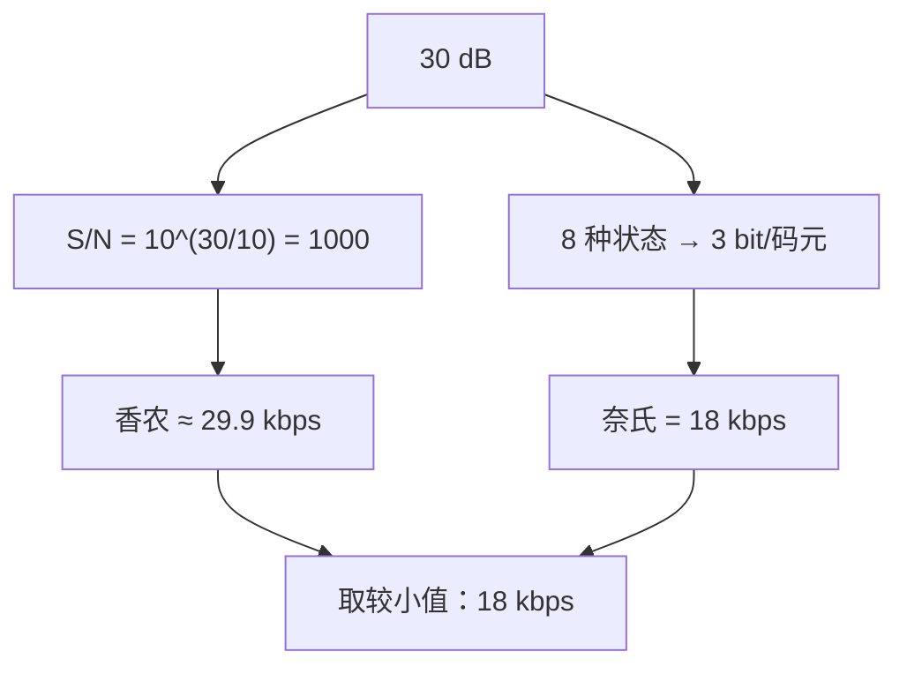

## 1. 题目

| 项目 | 内容 |
| :---: | :--- |
| **来源** | BOK27 考研每日一题 |
| **科目** | 计算机网络（CN） |
| **涉及知识点** | 信噪比 dB 换算、香农公式、奈氏准则 |

**题目内容**：某有噪声信道的带宽为 $3\text{ kHz}$，信噪比为 $30\text{ dB}$，系统采用 $8$ 种不同的离散信号状态。则该信道的最高数据传输速率为（ ）。

**选项**：

- A. $12\text{ kbps}$
- B. $18\text{ kbps}$
- C. $30\text{ kbps}$
- D. $48\text{ kbps}$

<!-- more -->

## 2. 我的作答

**我的答案**：**B**

**错选**：无（本题作答正确）

## 3. 正确答案与解析

**正确答案**：**B**

**题目解析**：

deepseek/deepseek-v4-flash 精修于 2026-11-09 20:35

已知 $W=3\text{ kHz}=3\times10^3\text{ Hz}$，$D=30\text{ dB}$，$V=8$。

**先把 dB 换成功率比**：

$$
D=10\log_{10}\left(\frac{S}{N}\right)
\quad\Longrightarrow\quad
\frac{S}{N}=10^{D/10}=10^{30/10}=10^3=1000
$$

**香农公式**（有噪声）：

$$
C_{\text{香农}}
=W\log_2\left(1+\frac{S}{N}\right)
=3\times10^3\times\log_2(1+1000)
\approx3\times10^3\times9.97
\approx29.9\text{ kbps}
$$

**奈氏准则**（理想无噪声）：

$$
C_{\text{奈氏}}
=2W\log_2 V
=2\times3\times10^3\times\log_2 8
=2\times3\times10^3\times3
=18\text{ kbps}
$$

有噪声信道取两者较小值：

$$
C_{\max}=\min(29.9,18)=18\text{ kbps}
$$

故选 B。

**精修说明**：原解析写“香农约为 $27\text{ kbps}$”偏小。$30\text{ dB}$ 对应 $S/N=1000$，$\log_2 1001\approx9.97$，香农结果约 $29.9\text{ kbps}$。不过即使按 $27\text{ kbps}$ 估算，取最小仍是 $18\text{ kbps}$，答案 B 不受影响。本题与 [CN_day2](/2026/11/07/cuotiben/bok27/CN/CN_day2/) 的区别是：day2 直接给 $S/N=15$，本题给的是 $30\text{ dB}$，必须先换算。

**图解**：

deepseek/deepseek-v4-flash 生成于 2026-11-09 20:35

**解题关键**：

> 有噪声信道两道公式都要算，取较小值；题目给 dB 时，先用 $S/N=10^{D/10}$ 换成功率比。

## 4. 知识点补充

deepseek/deepseek-v4-flash 生成于 2026-11-09 20:35

### 4.1 dB 与信噪比

$$
D=10\log_{10}\left(\frac{S}{N}\right)
\qquad
\frac{S}{N}=10^{D/10}
$$

| 分贝值 | 功率比 $S/N$ |
| :---: | :---: |
| $10\text{ dB}$ | $10$ |
| $20\text{ dB}$ | $100$ |
| $30\text{ dB}$ | $1000$ |
| $3\text{ dB}$ | $\approx2$ |

### 4.2 香农公式与奈氏准则

| 公式 | 适用条件 | 本题结果 |
| :--- | :--- | :---: |
| $C=W\log_2\left(1+\frac{S}{N}\right)$ | 有噪声信道 | $\approx29.9\text{ kbps}$ |
| $C=2W\log_2 V$ | 理想无噪声、码元状态数为 $V$ | $18\text{ kbps}$ |

有噪声时：

$$
C_{\max}=\min(C_{\text{香农}},C_{\text{奈氏}})
$$

### 4.3 易混淆概念

> **$30\text{ dB}$ ≠ $30$**：dB 是对数单位，$30\text{ dB}$ 对应功率比 $1000$，不是 $30$ 倍，也不是 $30\text{ dB}$ 直接代入香农公式。

> **香农结果 vs 最终答案**：本题香农约 $29.9\text{ kbps}$，奈氏 $18\text{ kbps}$；最终取较小值 $18\text{ kbps}$，不能因为香农更接近选项 C 就选 C。

> **day2 vs day4**：day2 给 $S/N=15$，直接代入；day4 给 $30\text{ dB}$，先换算成 $S/N=1000$。两者都是“两式都算、取最小”。
