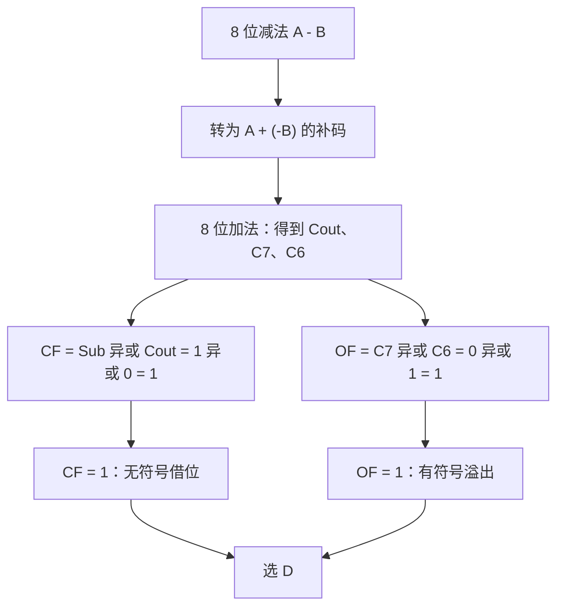

## 1. 题目

| 项目 | 内容 |
| :---: | :--- |
| **来源** | BOK27 考研每日一题 |
| **科目** | 计算机组成原理（CO） |
| **涉及知识点** | 补码减法、进位标志 CF、溢出标志 OF |

**题目内容**：在 8 位机器中，有符号整数采用补码表示。执行减法

$$
0110\,0001-1101\,1110
$$

若规定 $CF=1$ 表示无符号减法发生借位，则运算结束后 $CF$ 和 $OF$ 的值分别为（ ）。

**选项**：

- A. $CF=0,\ OF=0$
- B. $CF=0,\ OF=1$
- C. $CF=1,\ OF=0$
- D. $CF=1,\ OF=1$

<!-- more -->

## 2. 我的作答

<div style="margin:0 0 12px;padding:8px 14px;border-left:4px solid #e53935;border-radius:6px;background:rgba(229,57,53,.08);color:#e53935;font-weight:700">✘ 本题作答错误</div>

**我的答案**：<span style="color:#e53935;font-weight:700">B</span>

**错选**：<span style="color:#e53935;font-weight:700">B</span>

## 3. 正确答案与解析

**正确答案**：**D**

**题目解析**：

<span style="display:inline-block;padding:1px 8px;border:1px solid rgba(127,127,127,.35);border-radius:999px;background:rgba(127,127,127,.08);font-size:12px;line-height:20px">deepseek/deepseek-v4-flash 精修于 2026-11-09 16:25</span>

记

$$
A=0110\,0001_2=97,\qquad B=1101\,1110_2
$$

$B$ 按无符号数解释为 $222$，按 8 位补码解释为 $-34$。

**第一步：把减法转为补码加法。**

$$
A-B=A+[-B]_{\text{补}}
$$

对 $B$ 全部 8 位取反再加 $1$：

$$
\begin{aligned}
[-B]_{\text{补}}
&=\overline{1101\,1110}+1\\
&=0010\,0001+1\\
&=0010\,0010_2=34
\end{aligned}
$$

**第二步：做 8 位加法。**

```text
  0110 0001
+ 0010 0010
-----------
(0)1000 0011
```

结果为 $1000\,0011_2$，最高位向外的进位 $C_{\text{out}}=0$。

**第三步：判断 CF。**

本题约定 $CF=1$ 表示无符号减法发生借位。减法控制信号 $Sub=1$，因此

$$
CF=Sub\oplus C_{\text{out}}=1\oplus0=1
$$

从无符号数角度看：$97-222$ 不够减，需要借位，$CF=1$，与公式一致。

**第四步：判断 OF。**

8 位加法中，记 $C_7$ 为最高位向外的进位，$C_6$ 为次高位向高位的进位。本题

$$
C_7=C_{\text{out}}=0,\qquad C_6=1
$$

因此

$$
OF=C_7\oplus C_6=0\oplus1=1
$$

从有符号数角度看：$97-(-34)=131>127$，超出 8 位补码正数范围 $[-128,127]$，发生正溢出，$OF=1$，与公式一致。

所以 $CF=1,\ OF=1$，故选 D。

**图解**：

<span style="display:inline-block;padding:1px 8px;border:1px solid rgba(127,127,127,.35);border-radius:999px;background:rgba(127,127,127,.08);font-size:12px;line-height:20px">deepseek/deepseek-v4-flash 生成于 2026-11-09 20:25</span>



**错因分析**：选项 B 为 $CF=0,\ OF=1$，与本题结果不符。本题最高位向外虽然没有进位，但减法时 $CF$ 不能直接取 $C_{\text{out}}$，还要与减法控制信号 $Sub$ 异或，故 $CF=1$；同时有符号结果 $131$ 已溢出，$OF=1$，因此应选 D。

## 4. 知识点补充

<span style="display:inline-block;padding:1px 8px;border:1px solid rgba(127,127,127,.35);border-radius:999px;background:rgba(127,127,127,.08);font-size:12px;line-height:20px">deepseek/deepseek-v4-flash 生成于 2026-11-09 16:25</span>

### 4.1 补码减法

补码把减法统一为加法：

$$
[A-B]_{\text{补}}=[A]_{\text{补}}+[-B]_{\text{补}}
$$

其中

$$
[-B]_{\text{补}}=\overline{[B]_{\text{补}}}+1
$$

注意是**全部字长（含符号位）取反加 1**，不是只对数值位取反。

### 4.2 CF 与 OF

| 标志 | 含义 | 加法时的计算 | 减法时的计算 |
| :---: | :--- | :---: | :---: |
| $CF$ | 无符号数的进位/借位 | $CF=C_{\text{out}}$ | $CF=Sub\oplus C_{\text{out}}$ |
| $OF$ | 有符号数的溢出 | $OF=C_n\oplus C_{n-1}$ | $OF=C_n\oplus C_{n-1}$ |

- $Sub=1$ 表示减法，$Sub=0$ 表示加法。
- $C_n$ 为最高位向外的进位，$C_{n-1}$ 为次高位向最高位的进位。
- 减法时 $CF=1$ 表示**无符号数不够减、发生借位**。

也可以用真值范围判断溢出：

- 加法：两正数相加结果为负，或两负数相加结果为正 → 溢出。
- 减法：正数减负数结果为负，或负数减正数结果为正 → 溢出。

### 4.3 易混淆概念

> **CF 与 OF 相互独立**：$CF$ 站在无符号数角度，$OF$ 站在有符号数角度。一次运算可以“有进位但无溢出”，也可以“无进位但溢出”，本题就是后者（$C_{\text{out}}=0$ 但 $OF=1$）。

> **进位 ≠ 溢出**：最高位向外有进位，说明无符号结果超出字长；有符号溢出看的是符号位是否被破坏，即 $C_n\oplus C_{n-1}$。

> **减法时的 CF 不是 $C_{\text{out}}$**：在“减法转加法”的加法器中，$CF=Sub\oplus C_{\text{out}}$；直接把 $C_{\text{out}}$ 当借位会出错。

> **同一个二进制串的两种解释**：$1101\,1110_2$ 按无符号数是 $222$，按 8 位补码是 $-34$。题目问 $CF$ 时按无符号解释，问 $OF$ 时按有符号解释。

> **溢出后的结果不能按补码读真值**：本题结果 $1000\,0011_2$ 若硬按补码读是 $-125$，但数学上 $97-(-34)=131$，$-125$ 只是溢出后的错误编码，不能当作正确结果。
