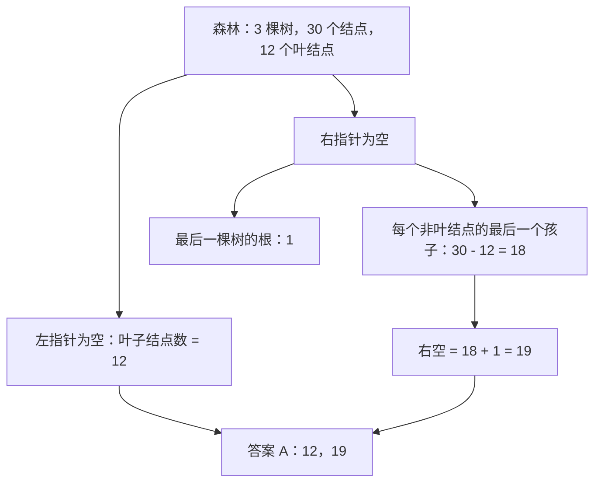

## 1. 题目

| 项目 | 内容 |
| :---: | :--- |
| **来源** | BOK27 考研每日一题 |
| **科目** | 数据结构（DS） |
| **涉及知识点** | 森林与二叉树转换、孩子-兄弟表示法 |

**题目内容**：森林 F 由 $3$ 棵树组成，共有 $30$ 个结点，其中有 $12$ 个叶结点。采用孩子-兄弟表示法将森林 F 转换为对应的二叉树 T。则二叉树 T 中左孩子指针为空和右孩子指针为空的结点数分别为（ ）。

**选项**：

- A. $12,\ 19$
- B. $12,\ 21$
- C. $18,\ 19$
- D. $18,\ 21$

<!-- more -->

## 2. 我的作答

✘ 本题未作答

**我的答案**：不会（未作答）

**错选**：未作答

## 3. 正确答案与解析

**正确答案**：**A**

**题目解析**：

deepseek/deepseek-v4-flash 精修于 2026-11-09 20:35

孩子-兄弟表示法遵循“**左孩子、右兄弟**”：

- 左指针指向第一个孩子，所以左指针为空 ⇔ 该结点没有孩子 ⇔ 是原森林的叶子结点。  
  因此左空结点数为 $12$。
- 右指针指向下一个兄弟，所以右指针为空 ⇔ 该结点没有下一个兄弟。

对非根结点，没有下一个兄弟的结点恰好是每个非叶结点的**最后一个孩子**。森林中非叶结点数为

$$
30-12=18
$$

每个非叶结点都有且仅有一个“最后一个孩子”，共 $18$ 个。

对根结点，三棵树的根在转换后互为兄弟：前两棵树的根都有右兄弟，只有**最后一棵树的根**没有右兄弟，贡献 $1$ 个。

所以右空结点数为

$$
18+1=19
$$

因此左空、右空分别为 $12,19$，选 A。

**精修说明**：原解析把“$1+18$”算成了 $21$，这是算术错误，正确结果是 $19$。另外，“树与树之间有隐形的双亲结点”只是帮助理解的比喻；实际是**各棵树的根互为兄弟**，计数时只额外算最后一棵树的根，不能把 $3$ 个根都算进去。

**图解**：

deepseek/deepseek-v4-flash 生成于 2026-11-09 20:35

**解题关键**：

> 左空看“有没有孩子”，右空看“有没有下一个兄弟”。非根结点的右空数 = 非叶结点数；再额外加最后一棵树的根。

## 4. 知识点补充

deepseek/deepseek-v4-flash 生成于 2026-11-09 20:35

### 4.1 森林转二叉树

| 原结构 | 二叉树中的指针 | 为空的条件 |
| :--- | :--- | :--- |
| 第一个孩子 | 左孩子指针 | 结点是叶子 |
| 下一个兄弟 | 右孩子指针 | 结点是最后一个孩子，或是最后一棵树的根 |

转换规则：每个结点左指针指向第一个孩子，右指针指向下一个兄弟；各棵树的根视为兄弟，依次挂在右指针上。

### 4.2 易混淆概念

> **左空 vs 右空**：左空数 = 叶子数；右空数 = 非叶结点数 $+1$（最后一棵树的根），不是叶子数。

> **“最后一个孩子” vs “最后一棵树的根”**：前者对每个非叶结点各有一个；后者只有森林中最后一棵树的根没有右兄弟，不能把 $3$ 个根都算进去。

> **非叶结点数**：$30-12=18$，其中包含有孩子的根结点；每个非叶结点都有且仅有一个“最后一个孩子”。
