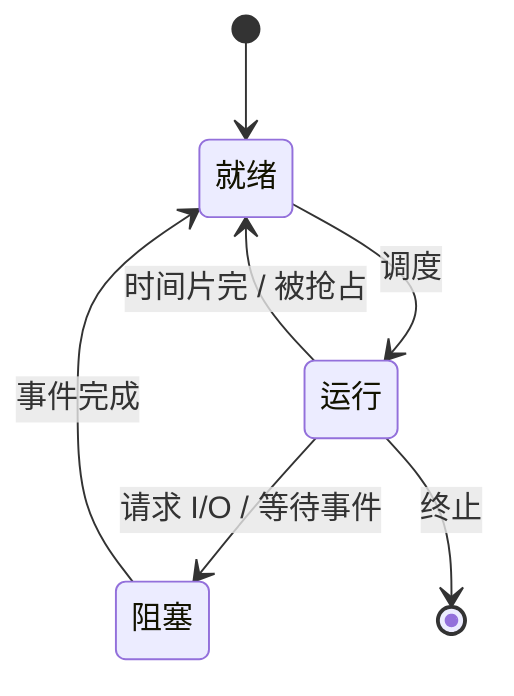

## 1. 题目

| 项目 | 内容 |
| :---: | :--- |
| **来源** | BOK27 考研每日一题 |
| **科目** | 操作系统（OS） |
| **涉及知识点** | 进程状态及其转换 |

**题目内容**：关于进程状态及其转换，下列说法正确的是（ ）。

**选项**：

- A. 运行态进程因请求 I/O 而转为阻塞态后，I/O 完成时可直接转为运行态
- B. 阻塞态进程等待的事件发生后，通常先转为就绪态
- C. 就绪态进程即使尚未获得处理机，也可以直接转为阻塞态
- D. 运行态进程只有在时间片用完时才可能转为就绪态

<!-- more -->

## 2. 我的作答

**我的答案**：**B**

**错选**：无（本题作答正确）

## 3. 正确答案与解析

**正确答案**：**B**

**题目解析**：

deepseek/deepseek-v4-flash 精修于 2026-11-09 16:25

逐项分析：

- **A 错**：运行态进程因请求 I/O 转为阻塞态；I/O 完成后，它只是重新具备运行条件，应先转为**就绪态**，等待调度程序分配处理机，不能直接转为运行态。
- **B 对**：阻塞态进程等待的事件发生后，转为就绪态，进入就绪队列；被调度程序选中后才转为运行态。
- **C 错**：就绪态进程尚未获得处理机，不能执行指令，也就不能主动请求 I/O 或等待事件，因此不能直接转为阻塞态。只有**运行态**进程才能因请求 I/O、等待事件而转为阻塞态。
- **D 错**：运行态进程转为就绪态有两种常见原因：时间片用完，或被更高优先级的进程**抢占**。因此“只有时间片用完”过于绝对。

故选 B。

**图解**：

deepseek/deepseek-v4-flash 生成于 2026-11-09 20:25

**解题关键**：

> 记住状态转换的方向：**阻塞 → 就绪 → 运行**。阻塞态不能直接到运行态；就绪态不能直接到阻塞态；运行态可以因时间片完或被抢占回到就绪态。

## 4. 知识点补充

deepseek/deepseek-v4-flash 生成于 2026-11-09 16:25

### 4.1 进程状态转换

| 转换 | 触发条件 | 说明 |
| :---: | :--- | :--- |
| 创建 → 就绪 | 进程创建完成、资源分配完毕 | 进入就绪队列 |
| 就绪 → 运行 | 调度程序选中 | 分配处理机 |
| 运行 → 就绪 | 时间片用完；被更高优先级进程抢占 | 让出处理机，回到就绪队列 |
| 运行 → 阻塞 | 请求 I/O；等待某事件；申请资源失败 | 主动放弃处理机 |
| 阻塞 → 就绪 | I/O 完成；等待的事件发生 | 进入就绪队列，等待调度 |
| 运行 → 终止 | 进程正常结束或异常终止 | 释放资源 |

### 4.2 易混淆概念

> **阻塞 → 运行？** 不行。事件完成只让进程“具备运行条件”，还要经过就绪队列，由调度程序选中后才能运行。

> **就绪 → 阻塞？** 不行。就绪态没有处理机，不能执行指令，也就不能主动请求 I/O；只有运行态才能转为阻塞态。

> **运行 → 就绪只有时间片用完？** 不是。抢占式调度中，更高优先级进程到达也可能把当前进程抢占回就绪态。

> **阻塞态 vs 就绪态**：两者都未运行，区别在于**是否具备运行条件**。就绪态只差处理机；阻塞态还在等事件，即使处理机空闲也不能运行。

> **进程 vs 程序**：程序是静态的指令集合，进程是程序的一次动态执行；进程有状态转换，程序没有。
