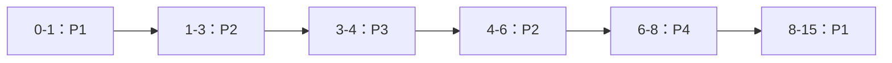

## 1. 题目

| 项目 | 内容 |
| :---: | :--- |
| **来源** | BOK27 考研每日一题 |
| **科目** | 操作系统（OS） |
| **涉及知识点** | 抢占式短作业优先（SRTF）、周转时间、甘特图 |

**题目内容**：某系统采用抢占式短作业优先调度算法（最短剩余时间优先，SRTF）。$4$ 个进程的到达时间和 CPU 运行时间如下表所示。

| 进程 | 到达时间 | CPU 运行时间 |
| :---: | :---: | :---: |
| $P_1$ | $0$ | $8$ |
| $P_2$ | $1$ | $4$ |
| $P_3$ | $3$ | $1$ |
| $P_4$ | $5$ | $2$ |

忽略进程切换开销，则 $4$ 个进程的平均周转时间为（ ）。

**选项**：

- A. $5$
- B. $6$
- C. $7$
- D. $8$

<!-- more -->

## 2. 我的作答

**我的答案**：**B**

**错选**：无（本题作答正确）

## 3. 正确答案与解析

**正确答案**：**B**

**题目解析**：

deepseek/deepseek-v4-flash 生成于 2026-11-09 20:35

SRTF 在每个进程到达或完成时，选择**剩余运行时间最短**的进程；若新到达进程的剩余时间更短，则抢占当前进程。

调度过程：

- $t=0$：只有 $P_1$，运行 $P_1$。
- $t=1$：$P_2$ 到达，剩余 $P_1=7$、$P_2=4$，$P_2$ 更短，抢占 $P_1$。
- $t=3$：$P_3$ 到达，剩余 $P_2=2$、$P_3=1$，$P_3$ 更短，抢占 $P_2$。
- $t=4$：$P_3$ 完成。剩余 $P_2=2$、$P_1=7$，运行 $P_2$。
- $t=5$：$P_4$ 到达，剩余 $P_2=1$、$P_4=2$，$P_2$ 仍更短，不抢占。
- $t=6$：$P_2$ 完成。剩余 $P_4=2$、$P_1=7$，运行 $P_4$。
- $t=8$：$P_4$ 完成，运行 $P_1$ 剩余 $7$ 个时间单位。
- $t=15$：$P_1$ 完成。

**图解**：

deepseek/deepseek-v4-flash 生成于 2026-11-09 20:35

完成时间与周转时间：

| 进程 | 到达时间 | 运行时间 | 完成时间 | 周转时间 | 等待时间 |
| :---: | :---: | :---: | :---: | :---: | :---: |
| $P_1$ | $0$ | $8$ | $15$ | $15$ | $7$ |
| $P_2$ | $1$ | $4$ | $6$ | $5$ | $1$ |
| $P_3$ | $3$ | $1$ | $4$ | $1$ | $0$ |
| $P_4$ | $5$ | $2$ | $8$ | $3$ | $1$ |

平均周转时间：

$$
\frac{15+5+1+3}{4}=\frac{24}{4}=6
$$

故选 B。

**解题关键**：

> SRTF 每次比较“剩余运行时间”，不是比较原始运行时间。新进程到达时，只有剩余时间更短才抢占；本题 $t=5$ 时 $P_4$ 就没有抢占 $P_2$。

## 4. 知识点补充

deepseek/deepseek-v4-flash 生成于 2026-11-09 20:35

### 4.1 SRTF 调度规则

- SRTF = Shortest Remaining Time First，是**抢占式**的 SJF。
- 每次有进程到达或完成时，选择剩余运行时间最短的进程。
- 若新到达进程的剩余时间严格小于当前进程，则发生抢占；否则当前进程继续。
- 相同剩余时间时，通常按先来先服务或题目约定处理。

### 4.2 周转时间与等待时间

$$
\text{周转时间}=\text{完成时间}-\text{到达时间}
$$

$$
\text{等待时间}=\text{周转时间}-\text{运行时间}
$$

本题平均周转时间：

$$
\bar T=\frac{15+5+1+3}{4}=6
$$

平均等待时间：

$$
\bar W=\frac{7+1+0+1}{4}=2.25
$$

### 4.3 易混淆概念

> **SJF vs SRTF**：SJF 通常指非抢占式，进程一旦运行就直到完成；SRTF 是抢占式，新进程剩余时间更短时会抢占当前进程。

> **周转时间 vs 等待时间**：周转时间从到达算到完成，包含运行和等待；等待时间 = 周转时间 − 运行时间。题目问平均周转时间，不要用等待时间代答。

> **$t=5$ 时 $P_4$ 为什么不抢占**：$P_4$ 的运行时间是 $2$，但 $P_2$ 此时只剩 $1$，$P_2$ 的剩余时间更短，所以继续运行 $P_2$。

> **甘特图区间**：$P_2$ 被 $P_3$ 抢占后，在 $t=4$ 继续运行；$P_1$ 被 $P_2$ 抢占后，直到 $t=8$ 才继续。看剩余时间，不要看原始运行时间。
