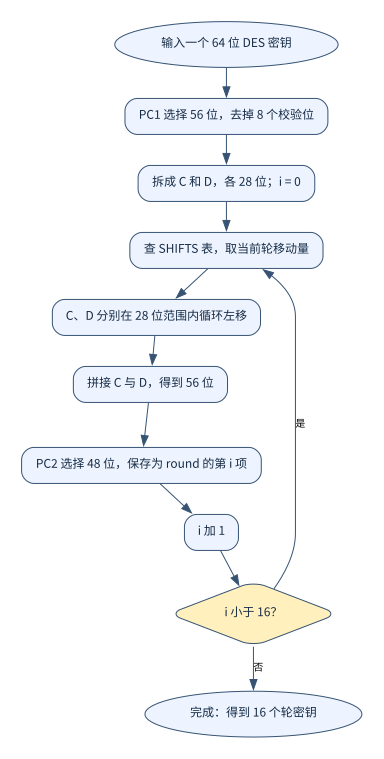
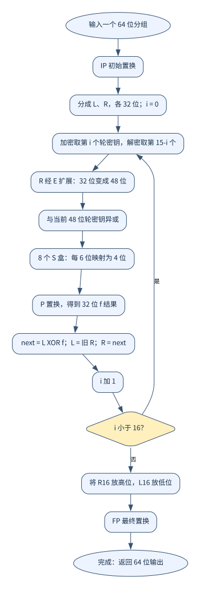
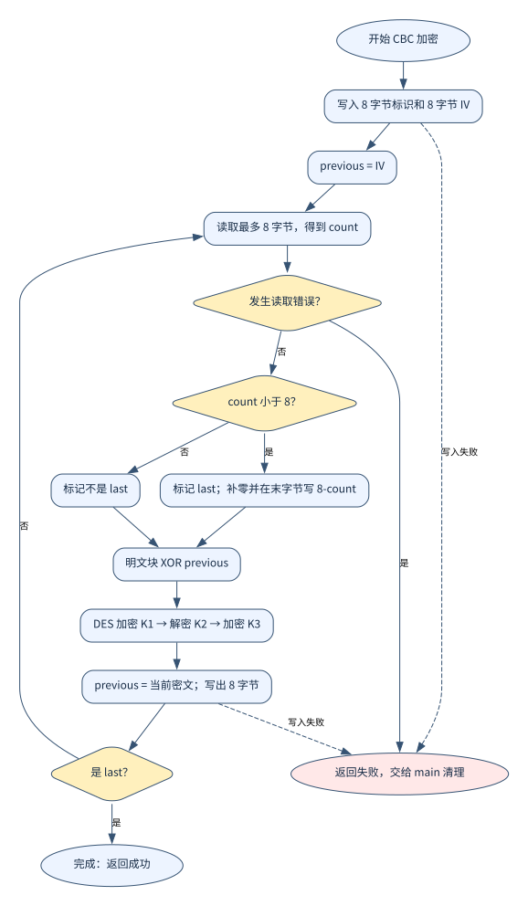
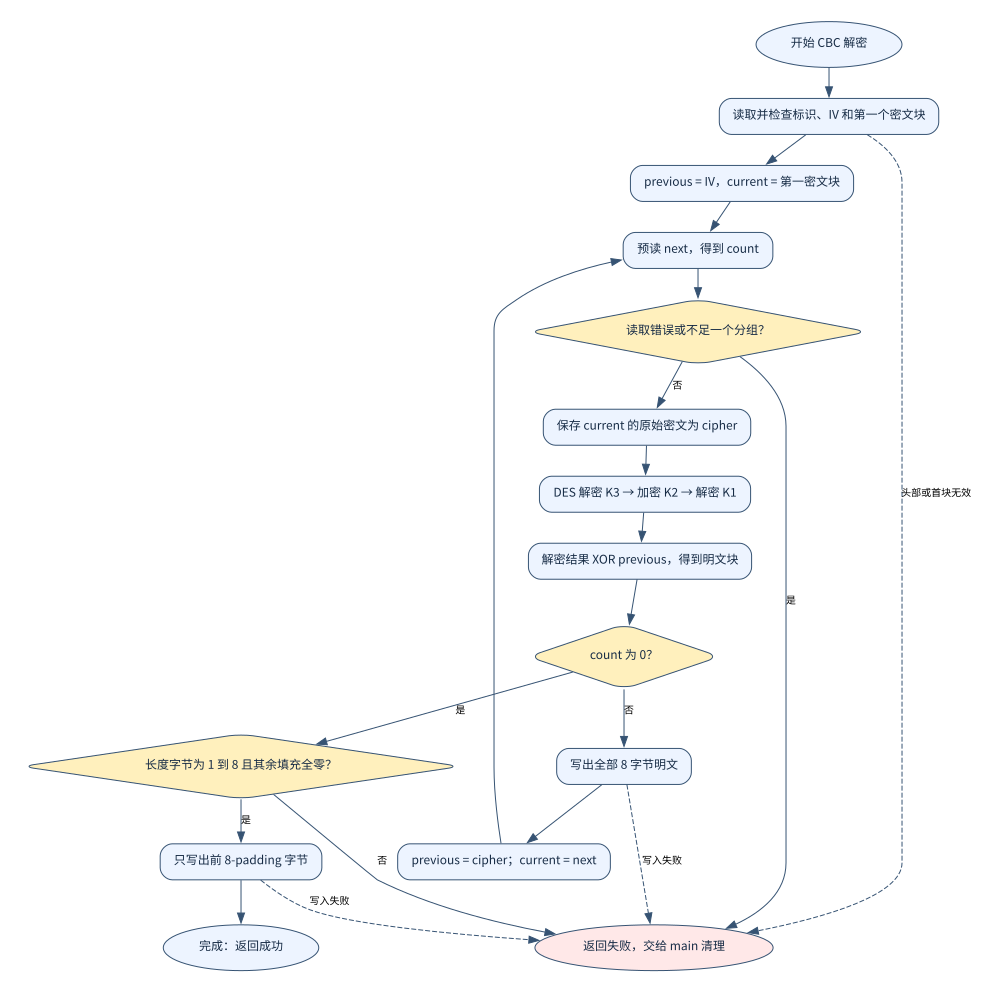
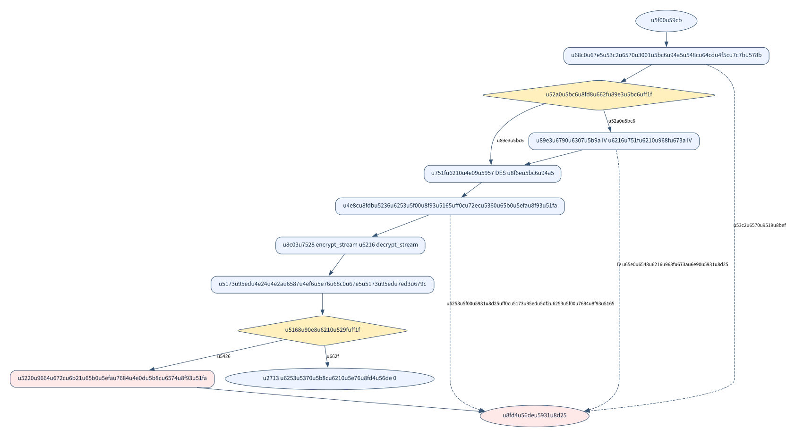

# 3DES 的实现与文件处理流程

代码分为三个部分：[des3.c](../../Study/信息安全/3DES实验/des3.c) 完成分组算法，[file_crypto.c](../../Study/信息安全/3DES实验/file_crypto.c) 把分组算法用于文件，[main.c](../../Study/信息安全/3DES实验/main.c) 管理命令行与文件打开关闭。本文先把算法与代码对应起来，再重点解释视频中容易略过的文件处理。

## 1. 算法怎样落到代码中

DES 一次输入和输出都是 8 字节。3DES 对同一个分组调用三次 DES，分组长度仍为 8 字节；24 字节是 K1、K2、K3 的总密钥长度。

| 理论步骤 | `des3.c` 中的实现 |
| --- | --- |
| 根据表重新选取各个位 | 私有函数 `permute` |
| PC1 → 两个 28 位部分循环左移 → PC2 | `des_key_init` 生成 16 个轮密钥 |
| E 扩展 → 异或轮密钥 → S 盒 → P 置换 | 私有函数 `des_f` |
| IP → 16 轮 Feistel → 交换 → FP | `des_block` |
| K1、K2、K3 分别生成轮密钥 | `triple_key_init` |
| 加密 EDE，解密反向 DED | `triple_block` |
| 8 字节数组与 64 位整数互相转换 | `load_be64`、`store_be64` |

### 位的选择和密钥调度

置换表从最高位开始，以 1 为起点编号；C 数组从 0 开始。`permute` 的核心是：

```c
result = (result << 1) | ((value >> (input_bits - table[i])) & UINT64_C(1));
```

`input_bits - table[i]` 把位号换成右移距离，`& 1` 取出该位，结果左移后再把这一位接到末尾。扩展表允许重复取位，PC1、PC2 则只选择一部分位。

DES 的 64 位输入密钥中有 8 位校验位，PC1 选出实际使用的 56 位。本程序按表忽略校验位。分成两个 28 位部分后，每轮循环左移，再由 PC2 选出 48 位轮密钥。

```c
c = ((c << shift) | (c >> (28 - shift))) & 0x0fffffffU;
```

左移出边界的位接回右侧，掩码保证保留 28 位。三段 DES 密钥各做一次调度，文件所有分组复用这三套轮密钥。



[Mermaid 源码](diagrams/02_key_schedule.mmd) · [PNG](diagrams/02_key_schedule.png)

### DES 的 16 轮与 3DES 的三次调用

每轮关系为 `新 L = 旧 R`，`新 R = 旧 L XOR f(旧 R, 轮密钥)`：

```c
uint32_t next = left ^ des_f(right, key->round[index]);
left = right;
right = next;
```

临时变量防止覆盖旧值。轮函数将 32 位扩展为 48 位，异或轮密钥，再由 8 个 S 盒各把 6 位映射为 4 位，最后做 P 置换。16 轮后按 `R16 || L16` 拼接并做 FP；这里 `||` 是数学上的拼接。

DES 解密复用同一结构，轮密钥倒序使用。3DES 再组合它：

```text
加密：明文 → DES加密(K1) → DES解密(K2) → DES加密(K3) → 密文
解密：密文 → DES解密(K3) → DES加密(K2) → DES解密(K1) → 明文
```



[Mermaid 源码](diagrams/03_des.mmd) · [PNG](diagrams/03_des.png)

## 2. 从“一个分组”到“一个文件”

文件是一串字节。程序不解释图片、中文或压缩格式，只读取字节，解密后按原顺序写回。因此不需要为不同扩展名写不同算法。

文件层需要解决五件事：打开文件；每次读取最多 8 字节；将完整分组送入 CBC；补齐最后不足 8 字节的部分；检查读写和关闭是否成功。解密还要识别最后一块，去掉填充。

### 2.1 `FILE *` 和二进制模式

`main.c` 打开输入、输出：

```c
FILE *input = fopen(argv[2], "rb");
```

```c
FILE *output = fopen(argv[3], "wbx");
```

`FILE *` 指向标准库管理的流对象，保存当前位置、缓冲区和状态等信息，不是把整个文件读进了指针。

| 标志 | 含义 |
| --- | --- |
| `r` | 读已有文件；路径不存在则打开失败 |
| `w` | 写入输出 |
| `b` | 二进制模式，按原始字节处理，避免文本模式下的字符转换 |
| `x` | C11 的独占创建标志，输出路径已经存在则失败 |

所以输入输出不能用同一路径，也不能把输入的硬链接当作已有输出。每次 `fopen` 后都检查是否为 `NULL`。若打开输入成功、新建输出失败，入口关闭输入后退出。

### 2.2 `fread` 的返回值才是长度

```c
size_t count = fread(block, 1, BLOCK_SIZE, input);
```

四个参数依次表示缓冲区、每个元素的大小、最多读取多少个元素、输入流。这里每个元素为 1 字节，所以返回值 `count` 就是本次读到的字节数，取值为 0～8。文件位置会向后移动已读取的字节数，下次继续读取后面的内容。

| 读取结果 | 加密时的含义 |
| --- | --- |
| 8 字节 | 得到完整分组，直接处理 |
| 1～7 字节，且没有读取错误 | 到达末尾，需要补齐 |
| 0 字节，且没有读取错误 | 没有剩余原文，需要构造完整填充分组 |
| `ferror(input)` 非零 | 读取失败，应停止，不应当作正常文件末尾 |

程序先调用 `fread`，再检查读取状态。不能用 `while (!feof(input))` 提前判断“下一次有没有数据”：只有读取碰到文件末尾后，流才会设置结束标志。

文件内容不能用 `strlen` 求长度。比如原始字节 `41 00 42` 的长度是 3，`strlen` 会在 `00` 处停止。代码中的 `strlen` 只用来验证命令行里的十六进制文本，文件数据始终使用实际字节数。

### 2.3 为什么还要字节转换

读取得到 `uint8_t block[8]`，DES 的位运算使用 `uint64_t`。`load_be64` 把 `01 23 45 67 89 AB CD EF` 组合为整数 `0x0123456789ABCDEF`；`store_be64` 再把整数拆回 8 个字节。

两者按固定的大端顺序逐字节处理，不依赖当前 CPU 的字节序。直接把 `uint8_t *` 强制转换为 `uint64_t *` 会涉及字节序和对齐问题，这里没有这样做。

## 3. 加密文件为什么有 16 字节头部

本实验自行定义输出格式：

| 偏移（从 0 开始） | 长度 | 内容 |
| --- | --- | --- |
| 0～7 | 8 字节 | ASCII 标识 `T3CBC001` |
| 8～15 | 8 字节 | CBC 的 IV，保存原始字节 |
| 16 起 | 8 的正整数倍 | 经过填充及 3DES-CBC 加密的密文主体 |

标识对应十六进制 `54 33 43 42 43 30 30 31`。它用于拒绝不属于本程序格式的输入，不证明文件内容未被修改。

IV 是第一块 CBC 运算需要的初始值，不是密钥，不必保密，因此和密文一起保存。解密从头部读取 IV，命令行只需要提供密钥。密钥本身不会写入文件。

这 16 字节是程序的文件封装，不是 DES 或 3DES 对单块输入的要求，也不参与 CBC 加密。独立对照时只比较偏移 16 之后的密文主体。

若原文为 `L` 字节，输出长度为：

```text
16 + (floor(L / 8) + 1) × 8
```

| 原文长度 | 密文主体长度 | 加上头部后的文件长度 |
| --- | --- | --- |
| 0 | 8 | 24 |
| 3 | 8 | 24 |
| 8 | 16 | 32 |
| 9 | 16 | 32 |
| 16 | 24 | 40 |

## 4. 加密：边读边处理，最后补齐

CBC 用 `previous` 保存上一块密文；第一块之前令它等于 IV：

```text
C0 = IV
Ci = 3DES加密(Pi XOR C(i-1))
```

`encrypt_stream` 先写标识与 IV，再循环读取分组。主要顺序是：

```text
读取最多 8 字节 → 检查读取错误 → 若不足则填充
→ 转成 64 位整数 → 异或 previous → 3DES 加密
→ 转回 8 字节 → 写出并检查写入量
→ 已处理填充末块则结束，否则继续
```

对应的 CBC 运算在 [file_crypto.c](../../Study/信息安全/3DES实验/file_crypto.c)：

```c
previous = triple_block(load_be64(block) ^ previous, key, 0);
store_be64(previous, block);
```

这里先与旧 `previous` 异或，再把新密文保存为 `previous`，供下一轮使用。同一个 `block` 缓冲区读入明文、随后保存密文；下轮读取会覆盖它，不需要保存所有旧分组。

### 4.1 ANSI X9.23 怎么补齐

私有函数 `add_padding` 只处理已有 0～7 字节的末块。需要填充 `8 - count` 字节：前面的填充位置写 `00`，最后一个字节记录填充长度。

| 情况 | 填充后的末块，十六进制 |
| --- | --- |
| 原文 `ABC`，3 字节 | `41 42 43 00 00 00 00 05` |
| 已有 7 字节 | 保留原有 7 字节，再加 `01` |
| 空文件或完整分组之后 | 新增 `00 00 00 00 00 00 00 08` |

**刚好 8 字节也要再加一块。** 第一次读取 8 字节，按普通块加密；第二次读取返回 0，再补整块。这样解密总能把最后一块按同一套规则处理，不会把原文最后一个字节误认为长度。

例如 `ABCDEFGH!` 共 9 字节：第一轮处理 `ABCDEFGH`；第二轮读到 `!`，补成 `21 00 00 00 00 00 00 07` 后处理并结束。实际写出的分组是密文，不是这里展示的填充明文。

### 4.2 写出多少，就检查多少

```c
if (fwrite(block, 1, BLOCK_SIZE, output) != BLOCK_SIZE) {
    return FILE_CRYPTO_IO_ERROR;
}
```

`fwrite` 的参数形式与 `fread` 相似。这里应写出 8 字节，返回值不足 8 就报告失败。文件头、IV 和恢复出的明文也分别检查写入量。



[Mermaid 源码](diagrams/04_encrypt.mmd) · [PNG](diagrams/04_encrypt.png)

## 5. 解密：为什么需要预读下一块

解密首先读取完整的 16 字节头部，检查标识，取出 IV，再读取第一块密文。即使原文为空也有一个填充分组，因此“只有头部、没有密文”的文件无效。

CBC 逆运算是：

```text
Pi = 3DES解密(Ci) XOR C(i-1)
```

问题是：除最后一块外，都要写回完整 8 字节；最后一块必须先去填充。仅凭当前 8 字节无法知道它是不是最后一块，因此使用 `current` 和 `next` 两个密文缓冲区。

```c
size_t count = fread(next, 1, BLOCK_SIZE, input);
```

| 预读结果 | `current` 的处理 |
| --- | --- |
| 8 字节 | 后面还有块，当前块按普通块解密，写出 8 字节 |
| 0 字节且没有读取错误 | 当前是最后一块，解密后校验填充，只写有效数据 |
| 1～7 字节 | 密文长度不是 8 的倍数，报错 |
| 读取错误 | 报错 |

也就是说，加密时最后不足 8 字节是正常情况，需要补齐；解密时密文不足 8 字节属于格式错误，不能擅自补密文。

### 5.1 保存原始密文以更新 CBC 链值

```c
uint64_t cipher = load_be64(current);
uint64_t value = triple_block(cipher, key, 1) ^ previous;
store_be64(value, plain);
```

先保存当前原始密文 `cipher`，再计算明文 `plain`。普通块处理后：

```c
previous = cipher;
memcpy(current, next, BLOCK_SIZE);
```

下轮的 `previous` 必须是这轮的原始密文。若误写成刚解出的明文，第二块开始就会解密错误。`next` 已经从文件中读出，复制为新的 `current` 后，只需再预读它后面的一块。

### 5.2 去填充为什么不会删除原文中的零

普通块令 `used = 8`；只有预读结果为 0 时，才调用私有函数 `remove_padding`：

1. 查看末字节，填充长度必须为 1～8。
2. 根据该长度，检查其余填充位置是否全部为 `00`。
3. 计算 `used = 8 - padding`，只写出前 `used` 个字节。

```c
if (fwrite(plain, 1, used, output) != used) {
    return FILE_CRYPTO_IO_ERROR;
}
```

例如末块是 `41 00 00 00 00 00 00 06`，填充长度为 6，保留前两字节 `41 00`。原文中的 `00` 仍然保留；不能用“从末尾删除所有零”的方法。

若原文为空，唯一密文块解开后为 `00 00 00 00 00 00 00 08`，`used = 0`，不写入数据，得到真正的空文件。



[Mermaid 源码](diagrams/05_decrypt.mmd) · [PNG](diagrams/05_decrypt.png)

## 6. 成功返回之后为什么还要检查 `fclose`

C 标准库可能先把 `fwrite` 的数据放到缓冲区，在缓冲区满或关闭流时才继续交给操作系统。因此写入时没有报错，不代表关闭时一定成功。

`main.c` 先检查流函数的结果，然后关闭两个流：

```c
int ok = result == FILE_CRYPTO_OK;
```

```c
if (fclose(input) != 0) {
    ok = 0;
}
if (fclose(output) != 0) {
    ok = 0;
}
```

只有处理、关闭都成功才输出“加密完成”或“解密完成”。若失败，入口尝试 `remove(argv[3])` 删除本次新建的不完整输出，删除失败也会提示。

解密中，发现最后一块填充错误之前，前面的明文可能已经写入输出。删除失败输出因此也是完整流程的一部分。程序被强制终止时，正常收尾代码可能来不及执行。

| 谁负责 | 操作 |
| --- | --- |
| `main.c` | `fopen`、显示结果、`fclose`、失败时 `remove` |
| `file_crypto.c` | `fread`、`fwrite`、文件头与分组格式检查，返回 `FileCryptoResult` |
| `des3.c` | 内存中的分组与密钥运算 |

文件处理始终只保存几个分组、固定头部和轮密钥，额外内存不会随文件大小增长。代码不需要先测文件总长度，也不需要把整个文件放入数组。



[Mermaid 源码](diagrams/01_main.mmd) · [PNG](diagrams/01_main.png)

## 7. 自己编码和验证的顺序

1. 在 `des3.c` 写字节转换、置换、轮密钥和 DES 单块函数，用已知向量检查。
2. 用三次 DES 组合 `triple_block`，检查 EDE / DED 的密钥顺序。
3. 在 `file_crypto.c` 写末块填充与去填充，再接上 CBC 和分组读写。
4. 在 `main.c` 解析参数、准备密钥与 IV，打开流并调用加密或解密，最后统一关闭和清理。
5. 先用 0、3、8、9 字节文件观察边界，再测试图片、中文和大一些的文件；与独立实现比较密文。

可按笔记中的演示进行加密、解密，再用 `cmp` 比较恢复文件和原文件。填充检查只是格式检查，不能保证识别每次错误密钥或密文修改；文件格式没有认证标签。
