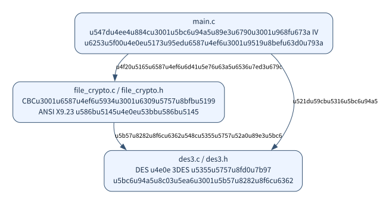

# 三个模块的职责

工程共 3 个 `.c` 和 2 个 `.h`，只维护一套代码。按“入口、分组算法、文件处理”划分，辅助函数就近放在使用它们的模块里。

```text
3DES实验/
├── main.c                   命令行与文件生命周期
├── des3.c / des3.h          DES、3DES、轮密钥、字节转换
├── file_crypto.c / .h       文件头、CBC、填充、按块读写
├── Makefile
└── build/                  目标文件、依赖文件和可执行程序 des3
```

## 1. 为什么这样划分

| 模块 | 负责什么 | 对外接口 |
| --- | --- | --- |
| `main.c` | 解析命令、密钥与 IV；打开关闭文件；显示错误；清理失败输出 | 程序入口 `main` |
| `des3.c` | DES 轮密钥、轮函数和单块运算；组合 3DES；字节数组与整数转换 | `DesKey`、`TripleKey`、`des_key_init`、`des_block`、`triple_key_init`、`triple_block`、`load_be64`、`store_be64` |
| `file_crypto.c` | 读写 16 字节头部；CBC 链接分组；末块填充与校验；读写文件流 | `FileCryptoResult`、`encrypt_stream`、`decrypt_stream` |

DES 和 3DES 在同一文件中，阅读 `triple_block` 时可以直接向上查看它调用的 `des_block`。字节转换是分组算法与文件之间的连接，也放在 `des3.c`。填充只服务于文件末块，留在 `file_crypto.c`。十六进制参数解析和随机 IV 只供入口使用，留在 `main.c`。

这些内部函数使用 `static`，无需再增加单独的头文件。`des3.h` 同时定义 `BLOCK_SIZE = 8`、`KEY_SIZE = 24` 等共享常量。



[Mermaid 源码](diagrams/06_modules.mmd) · [PNG 图片](diagrams/06_modules.png)

## 2. 仍然保留哪些边界

`des3.c` 只处理内存中的一个分组，不知道文件路径、CBC 或命令行。`file_crypto.c` 调用它完成每个分组的加解密，并通过返回值报告状态。

`main.c` 拥有文件流：负责 `fopen`、`fclose` 和失败时的 `remove`。流函数只使用传入的 `FILE *`，不关闭文件，也不向终端打印。这样算法可以单独复用，文件操作的收尾集中在入口。

| 返回值 | 含义 |
| --- | --- |
| `FILE_CRYPTO_OK` | 分组处理成功；入口还需要检查关闭文件是否成功 |
| `FILE_CRYPTO_IO_ERROR` | 读取或写入失败 |
| `FILE_CRYPTO_BAD_HEADER` | 头部不完整或标识错误 |
| `FILE_CRYPTO_BAD_LENGTH` | 缺少密文分组，或密文主体未按 8 字节对齐 |
| `FILE_CRYPTO_BAD_PADDING` | 最后一块的填充不合法 |

判断成功时写 `result == FILE_CRYPTO_OK`。该枚举的成功值为 0，不能直接把返回值当成“非零表示成功”的布尔结果。

## 3. 头文件与编译

[des3.h](../../Study/信息安全/3DES实验/des3.h) 和 [file_crypto.h](../../Study/信息安全/3DES实验/file_crypto.h) 声明类型、常量和函数接口；对应 `.c` 文件给出函数体。入口通过 `#include` 头文件获知调用方式，链接器再把调用与实现连接起来。

项目没有 `#include` 其他 `.c` 文件。头文件中的 `#ifndef` / `#define` / `#endif` 防止同一声明被重复展开。

```bash
make
```

或者一次性编译并链接三个源文件：

```bash
mkdir -p build
cc -std=c11 -O2 -Wall -Wextra -Wpedantic main.c des3.c file_crypto.c -o build/des3
```

只编译 `main.c` 会缺少它调用的函数定义。用法与演示见 [3DES.md](3DES.md)，读写细节见 [实现与流程.md](实现与流程.md)。
